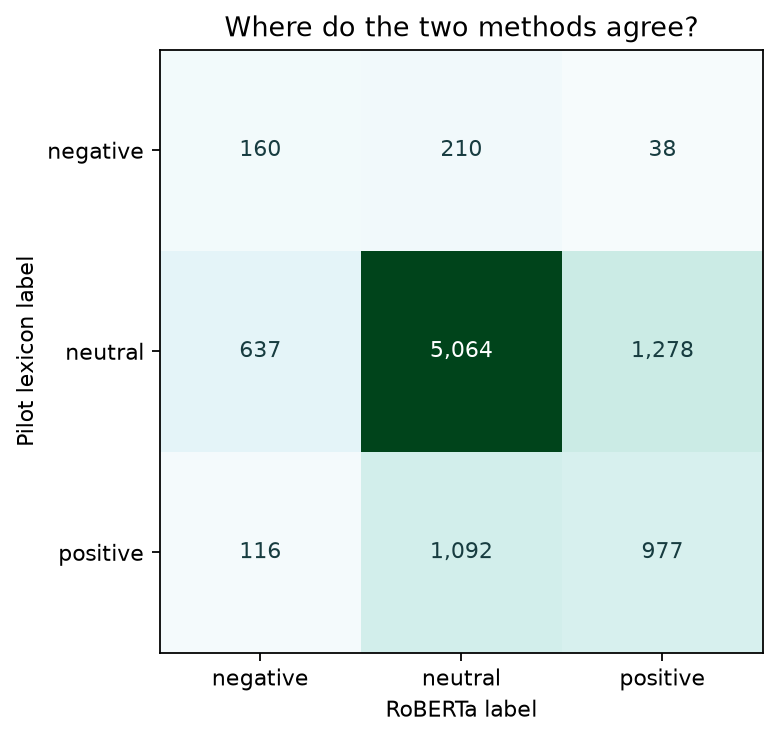
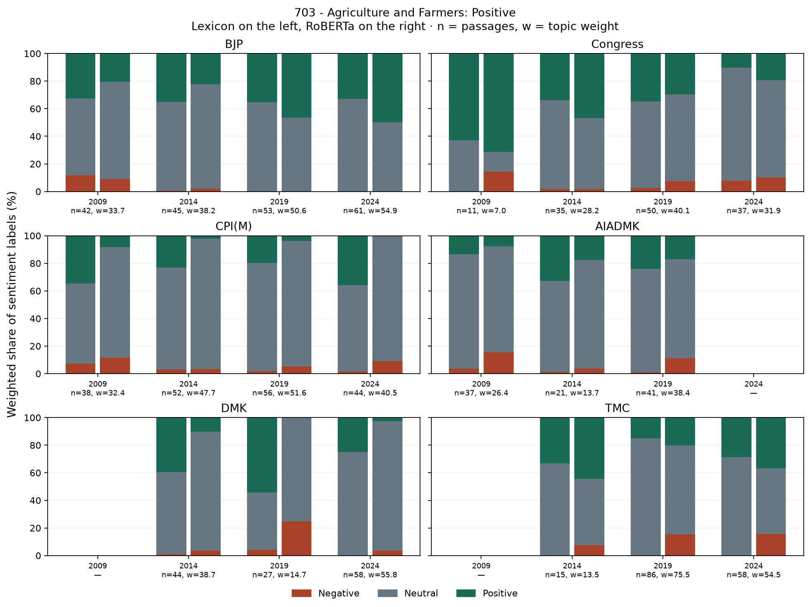
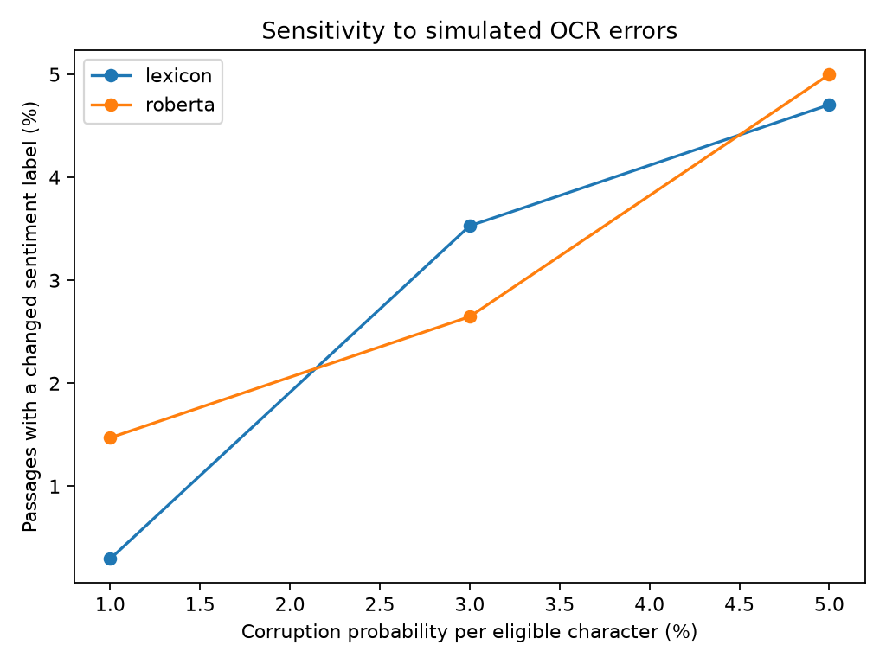

# Sentiment in Indian Election Manifestos

## 1. Introduction

The pilot used a balanced sample of 832 passages from four parties’ 2024 manifestos. It used a word-count lexicon for sentiment and explored topics with LDA and NMF. The extension expands coverage to six parties and four elections while keeping the lexicon as the baseline for passage-level comparison. The larger corpus supports comparisons over time. Party-year shares use the observed passage counts for each manifesto, and the figures show those denominators.

Pretrained RoBERTa adds a contextual sentiment score for each passage. ManifestoBERTa supplies a shared set of policy categories for tracing tone within the same issue. The analysis audits disagreements, compares tone within agriculture across parties and elections, and tests how sensitive sentiment labels and party comparisons are to the measurement method. [Original pilot](https://github.com/Sukrit0210/indian-manifesto-text-mining) · [Disagreement audit](src/04_analyze.py) · [Chart code](src/05_plot.py)

## 2. Objectives

1. Compare the word-count sentiment baseline with a pretrained contextual model on the same passages.
2. Measure sentiment by party, election, and policy category.
3. Use a source-linked audit to see where the methods disagree.
4. Measure how often the methods reverse the ordering of two parties and how their labels respond to controlled text changes.

## 3. Data Sources

The corpus comprises 21 English Lok Sabha manifestos and 9,572 retained passages or list items. BJP, Congress, and CPI(M) have editions for 2009, 2014, 2019, and 2024. AIADMK has editions for 2009, 2014, and 2019. DMK and TMC have editions for 2014, 2019, and 2024. The study required an existing English edition and could not verify one for AIADMK in 2024. Each passage has a stable ID, party, election, PDF page, source URL, and extraction method. [Source inventory](data/sources.csv) · [Source counts](data/processed/source_counts.csv) · [Edition notes](data/edition_notes.md)

## 4. Dataset Construction

Verify each edition using its recorded SHA-256. Extract text with PyMuPDF and apply English OCR where needed. Remove repeated page furniture, selected contents pages, and duplicate passages within a document. Keep the PDF page and extraction method so each row can be traced back to its source. The dataset uses the retained passages from each edition, with observed counts as the denominators for party-year shares.

The completed Windows run used Python 3.14 and PyTorch 2.10.0 with CUDA 12.6 on an RTX 4060 Laptop GPU. The rebuilt master CSV matched the earlier reference byte for byte. The two sentiment labels also matched the reference for all 9,572 passage IDs. This verifies reproducibility of the corpus and label decisions for this rerun. [Current corpus](data/processed/master_passages.csv) · [Saved corpus](reference/master_passages.csv) · [Current scores](outputs/scores.csv) · [Saved scores](reference/scores.csv)

## 5. Sentiment Analysis Method

### Original lexicon

Count the 22 positive and 21 negative words from the original project. The score is `(positive count − negative count) / (positive count + negative count + 1)`. Values above 0.05 are positive, values below −0.05 are negative, and the rest are neutral. [Lexicon code](src/lexicon.py)

### RoBERTa

Apply pretrained CardiffNLP Twitter-RoBERTa to the same passages. Split long passages into windows of up to 256 tokens and average the window probabilities by token count. Use the highest probability to assign the passage label. The model was trained for sentiment on English social media. [RoBERTa model card](https://huggingface.co/cardiffnlp/twitter-roberta-base-sentiment-latest)

## 6. Policy Topic Method

Split each passage into shorter units and assign one of the 56 ManifestoBERTa policy categories to each unit. If three of four units in a passage belong to one category, that category receives 0.75 passage weight. Each passage with topic assignments contributes one unit of weight across all its assigned categories. In a category name such as *Agriculture and Farmers: Positive*, “Positive” belongs to the policy coding scheme. Sentiment comes from the lexicon or RoBERTa. [ManifestoBERTa model card](https://huggingface.co/manifesto-project/manifestoberta-xlm-roberta-56policy-topics-sentence-2023-1-1) · [Checkpoint hashes](data/models.json)

## 7. Disagreement Audit Method

Compare the two sentiment labels and flag passages with simple text cues for negation, criticism, or a combination of commitment and problem language. Count disagreements among all passages that meet each cue. Categories can overlap. Review the source-linked examples to see how the language is used in context. [Analysis script](src/04_analyze.py)

The sensitivity audit compares negative shares between every pair of parties with topic coverage in the same election. A reversal means that the party with the higher negative share under one method has the lower share under the other. A tie under either method is counted separately. The minimum topic weight is applied to each party in a comparison. [Sensitivity script](src/06_audit_sensitivity.py)

For simulated OCR, the audit samples up to 20 digitally extracted passages per manifesto using a stable hash of each passage ID. It repeats the test on the same passages at three corruption probabilities, applying selected character substitutions and dropped spaces. A separate test swaps BJP and Congress wherever their names occur in sampled passages. Four constructed examples add negation to otherwise positive wording. [Individual audit cases](outputs/sensitivity/perturbation_cases.csv)

## 8. Sentiment Results

Both methods scored the same 9,572 passages. They agreed on **6,201 (64.8%)** and disagreed on **3,371 (35.2%)**.

| Sentiment label | Pilot lexicon | RoBERTa |
|---|---:|---:|
| Positive | 2,185 (22.8%) | 2,293 (24.0%) |
| Neutral | 6,979 (72.9%) | 6,366 (66.5%) |
| Negative | 408 (4.3%) | 913 (9.5%) |

Neutral was the most frequent label for both methods. The two largest disagreement groups were 1,278 lexicon-neutral passages that RoBERTa labelled positive, and 1,092 lexicon-positive passages that RoBERTa labelled neutral. [Agreement counts](outputs/sentiment_confusion.csv)

## 9. Sentiment by Party, Election, and Policy Topic

ManifestoBERTa made **15,376 short-unit assignments** across **9,493 passages**. The 79 passages without topic assignments still count in the overall sentiment analysis. The party-year plots show passage counts and leave gaps where a manifesto is absent from the corpus. [Topic coverage](outputs/topic_coverage.csv) · [Party-year figure](outputs/figures/02_party_year_trends.png)

Among the eight categories shown in the topic figure, *Political Authority* had the largest gap in negative sentiment. RoBERTa assigned negative labels to **32.7%** of its weighted passage total, compared with **6.9%** for the lexicon. The methods were much closer in *Welfare State Expansion*, at **3.9%** and **3.9%** to one decimal place. [Topic totals](outputs/by_topic.csv) · [Negative sentiment by policy topic](outputs/figures/03_sentiment_by_topic.png)

The agriculture breakdown shows why topic-level comparisons matter. For BJP, the RoBERTa positive share across the entire manifesto went from **53.4% in 2019** to **51.4% in 2024**. Within *Agriculture and Farmers: Positive*, it went from **46.6%** to **49.9%**. The agriculture estimates use 53 and 61 distinct passages, with 50.6 and 54.9 weighted passages respectively. The plot shows all three sentiment labels for both methods and labels each party-year’s denominator. [Party-year counts](outputs/by_party_year.csv) · [Topic breakdown](outputs/by_party_year_topic.csv)

## 10. Disagreement Audit Results

| Text cue | Passages | Disagreements | Share |
|---|---:|---:|---:|
| All passages | 9,572 | 3,371 | 35.2% |
| Negation marker | 811 | 392 | 48.3% |
| Criticism marker | 38 | 28 | 73.7% |
| Commitment and problem language | 51 | 37 | 72.5% |
| None of the tracked cues | 8,688 | 2,924 | 33.7% |

The criticism and commitment-plus-problem groups had high disagreement rates in this corpus and small denominators. The cues are phrase matches, so the rates describe association within the corpus. They cannot establish which method made the better decision. One source-linked example is passage `BJP-2009-p017-b008-i001` on page 17. It introduces a commitment to food security and eliminating hunger. The lexicon labelled it negative and RoBERTa labelled it positive. [Cue summary](outputs/disagreement_by_cue.csv) · [Source-linked examples](outputs/disagreement_cue_examples.csv)

## 11. Sensitivity Results

| Minimum topic weight for each party | Comparisons | Reversed | Same ordering | Tie under either method |
|---:|---:|---:|---:|---:|
| 0 | 1,629 | 338 (20.7%) | 564 | 727 |
| 5 | 681 | 220 (32.3%) | 306 | 155 |
| 10 | 415 | 145 (34.9%) | 192 | 78 |

Reversal percentages use all comparisons at each threshold, including ties. For example, in the 2024 agriculture category, the lexicon gave Congress a negative share 7.8 percentage points higher than TMC's. RoBERTa gave Congress a negative share 5.4 points lower than TMC's. The comparison used 31.9 weighted passages for Congress and 54.5 for TMC. The thresholds select different sets of comparisons. [Ordering summary](outputs/sensitivity/ordering_summary.csv) · [All party comparisons](outputs/sensitivity/party_orderings.csv)

| Text change | Cases | Lexicon label changes | RoBERTa label changes |
|---|---:|---:|---:|
| Add negation in constructed examples | 4 | 0 | 4 |
| Swap BJP and Congress names | 296 | 0 | 9 (3.0%) |
| Simulate OCR at 1% per eligible character | 340 | 1 (0.3%) | 5 (1.5%) |
| Simulate OCR at 3% per eligible character | 340 | 12 (3.5%) | 9 (2.6%) |
| Simulate OCR at 5% per eligible character | 340 | 16 (4.7%) | 17 (5.0%) |

All four negation edits lowered the RoBERTa score. Across the three OCR settings, the percentages use the same 340 sampled passages, including passages where the simulation left the text intact. The label changes measure sensitivity to the simulated errors. Estimating the OCR error rate on the source PDFs would require direct comparisons with transcriptions. [Perturbation summary](outputs/sensitivity/perturbation_summary.csv)

### Expanded negation test

The audit searched for a single unambiguous evaluative clause per passage and found three eligible direct source edits. To reach five cases per manifesto, it added 102 constructed evaluative clauses to source passages. Each pair inserts `not` at a recorded offset. The expected direction depends on the adjective being negated. The audit measures the movement of the lexicon score and of RoBERTa’s positive probability minus its negative probability. [Coverage by manifesto](outputs/sensitivity/expanded/negation_coverage.csv) · [Text pairs and offsets](outputs/sensitivity/expanded/negation_cases.csv)

| Case type | Pairs | Lexicon expected direction | RoBERTa expected direction | RoBERTa label changes |
|---|---:|---:|---:|---:|
| Direct source edit | 3 | 0 | 3 | 1 |
| Constructed clause with manifesto context | 102 | 0 | 102 | 86 |

The lexicon score stayed fixed on all pairs. RoBERTa responded in the specified direction on all 105 pairs, with 87 discrete label changes. The constructed tests measure responses to a small family of explicit clauses in varied manifesto contexts. Accuracy on naturally occurring negation would require independent labels. [Negation summary](outputs/sensitivity/expanded/negation_summary.csv)

### Size of the party-ordering differences

For the 145 reversals where both parties had at least 10 weighted passages, the median absolute difference between the two methods’ estimates of the party gap was **8.2 percentage points**. For the 192 comparisons where both methods gave the same ordering, it was **3.9 points**. The perturbation tables also give counts by manifesto, party and year. For example, RoBERTa’s nine name-swap label changes occurred in Congress (5 of 80), DMK (2 of 36) and TMC (2 of 46) source passages. [Gap sizes](outputs/sensitivity/expanded/ordering_gap_sizes.csv) · [Perturbations by group](outputs/sensitivity/expanded/perturbations_by_group.csv)

### Agreement with BART on a common sample

The expanded comparison uses 50 reproducibly sampled passages from each of the 21 manifestos. The sampler allocates each document’s quota proportionally across strata defined by the dominant policy topic and the tracked linguistic cues. Both BART prompt variants use the same 1,050 passages. The frozen BART model scores entailment for positive, neutral, and negative tone hypotheses and selects the label with the highest entailment logit. It caps inputs at 512 tokens. The second prompt replaces the generic neutral hypothesis with a description of factual or procedural language without clear praise or criticism. The positive and negative hypotheses stay the same. [Comparison script](src/07_expanded_audit.py)

| Method | Negative | Neutral | Positive |
|---|---:|---:|---:|
| Lexicon | 43 | 754 | 253 |
| RoBERTa | 93 | 698 | 259 |
| BART, original prompt | 386 | 20 | 644 |
| BART, neutral-explicit prompt | 71 | 887 | 92 |

| Methods | Agreements out of 1,050 | Share |
|---|---:|---:|
| Lexicon and RoBERTa | 662 | 63.0% |
| Lexicon and BART, original prompt | 246 | 23.4% |
| RoBERTa and BART, original prompt | 359 | 34.2% |
| Lexicon and BART, neutral-explicit prompt | 673 | 64.1% |
| RoBERTa and BART, neutral-explicit prompt | 774 | 73.7% |
| BART, original and neutral-explicit prompts | 183 | 17.4% |

Changing the neutral hypothesis changed 867 labels and increased the neutral share from 1.9% to 84.5%. The result demonstrates how strongly zero-shot sentiment depends on the prompt in this sample. The higher agreement describes closer alignment with the other methods. Independent labels would be needed to compare accuracy. [Sample labels](outputs/sensitivity/expanded/bart_cases.csv) · [Label counts](outputs/sensitivity/expanded/bart_label_counts.csv) · [Agreement summary](outputs/sensitivity/expanded/bart_agreement.csv)

## 12. Discussion

Both methods found mostly neutral language. The choice of method materially affected how often passages were labelled negative, and the direction of a party-year change could differ within a single issue. For example, the two methods disagree on passages that name a problem while promising to address it. Looking at the passage and its policy category helps explain why a count of negative words and a contextual model can produce different labels.

## 13. Limitations

RoBERTa was pretrained for English social media sentiment. Topic assignments and OCR can introduce errors, and available English editions vary by party and year. The passages come from the same set of documents, so the shares describe the included corpus. The agreement rate measures how often the methods chose the same label. Measuring accuracy on this corpus requires independent sentiment labels.

## 14. Future Improvements

A later validation study could have independent readers label a sample of passages from different parties, years, and topics. Include passages where the models agree and where they disagree. This would allow a future study to estimate the accuracy of each method and see which types of text account for their errors.

## 15. Conclusion

The expanded dataset let us compare manifesto tone across six parties and four elections. The two methods agreed on about two-thirds of passages, while RoBERTa assigned negative sentiment more than twice as often. The agriculture comparison shows that an overall party trend can differ from the trend within an issue. Among the 415 party comparisons with at least 10 weighted passages per party, 145 reversed. The ordering table identifies which comparisons depend on the method. Across the 1,050 sampled passages, a single change to BART’s neutral hypothesis changed 867 predictions, adding prompt wording as another measurement choice that affects the results.

## 16. References

- [Text Mining Indian Election Manifestos, original pilot](https://github.com/Sukrit0210/indian-manifesto-text-mining)
- [CardiffNLP Twitter-RoBERTa sentiment model](https://huggingface.co/cardiffnlp/twitter-roberta-base-sentiment-latest)
- [ManifestoBERTa policy category model](https://huggingface.co/manifesto-project/manifestoberta-xlm-roberta-56policy-topics-sentence-2023-1-1)
- [Manifesto Project coding handbook](https://manifestoproject.wzb.eu/information/documents?name=handbook_v4)
